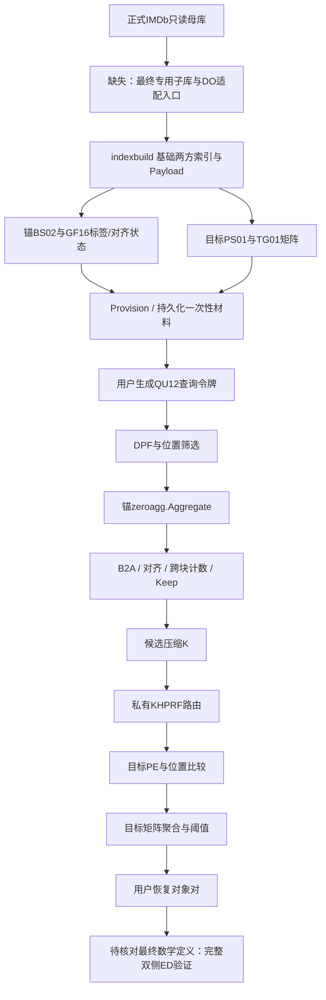

# 04 当前正式混合算子的生产调用图

本图仅分析主目录实际源码：锚零点聚合＋目标矩阵聚合。目标零点历史工作树不在本链中。包级原语已存在，不等于已有电影生产入口；本轮未调用秘密算子。

## 入口状态

- 原始数据→正式三表：`imdb_final_dataset/scripts/prepare_sources.py` → `build.py` → `validate.py`/`verify_raw_independently.py` → `deliver.py`。此链已完成，禁止本轮重跑。
- **正式IMDb密码外包CLI：缺失。** 主目录没有`cmd/`电影命令。`indexbuild.Build`等是库级DO入口，输入仍为音乐投影。不能将旧测试自动建库当作正式入口。
- **双云库级入口：存在。** `discovery.NewStatic` → `Provision`/`PersistReservation` → `RunCloudLocal` → 每方`runParty`。
- `RunCloudLocal`为本地两方传输/用户协调器，使用goroutine和字节信道，不是已部署的远程双云服务。不得把本地编译或画像计数写成远程性能。
- 用户恢复：D26走`RecoverForDomain`；D16另有`EncodeSelected/DecodeSelected`与PairSelection。正式用户CLI、可信IDmap加载和精确ED结果语义尚需按批准方案接上。

## 逐阶段接口、共享域和依赖

| 阶段 | 当前文件与函数 | 输入→输出与共享域 | 公开参数/离线/持久化依赖 | 生产状态与电影缺口 |
|---|---|---|---|---|
| DO输入 | `internal/indexbuild/parser.go`: LoadArea/LoadAreaAlias | PostgreSQL COPY→AreaRecord(ID,Name)/AreaAliasRecord(ID,Name,Area)；DO持明文 | 14/16列、uint64、旧音乐字段 | 旧输入专用；缺最终电影固定投影与IDmap |
| q片段 | `indexbuild/builder.go`: VisitQGrams/buildLogicalProjection | 全部重叠Unicode q4位置；锚按q分组，目标按(join,q)分组 | Q=4；每组梯度4..32768 | 可用库；q/字段/位置元数据必须贯通，不截原字符串 |
| 锚密钥域 | `anchorindex/logical_key.go` canonicalAnchorLogicalKey、`encode.go` Encode | 长度帧(BSMJ,area,name,id,q)→HMAC-SHA256前128位 | 用户/DO锚密钥，固定域 | 仍绑定音乐标识；未来需一次统一换成固定电影字段描述符 |
| 目标密钥域/分桶 | `targetcrypto/canonical.go` CanonicalJoin/Word、`bucket.go` JoinBucketComponent/WordBucketComponent | uint64BE连接与(PSMJ,area_alias,name,area,q)→标量/点路由分量，桶为XOR | Ristretto标量域；桶位数 | 库实现存在，电影编码及字段域尚缺；不能只改一侧 |
| 基础索引/分享 | `indexbuild/builder.go` Build/shareAndPad；`target_artifact.go` BuildFinalTargetWithBits/WriteTargetParty | 明文ID、位置、有效位→Ring64/Ring32/F2分享；目标point share | PadWidth、IndexID、PS01 manifest与SHA | 目前在内存构造map和两份PartyIndex；缺正式电影DO和资源拒绝门 |
| 全局载荷 | `aggregation/payload.go` GeneratePayloadWithJoins/Alignment；`targetartifact/payload.go` WritePayload/ReadPayload | 独立对象ID和连接ID→Ring64对象ID、Ristretto标量、桶XOR份额 | LayoutID，N_anchor，π/ρ/σ；PL01 | 已支持对象≠连接；N表示锚域，不能误用目标行数；完整专用IDmap/manifest缺失 |
| 锚局部标签 | `incidence/core.go` PrepareLayout；`zeroagg/labels.go` ShareCoordinates | 真实来源对象→局部坐标→GF16标签份额 | T、D、LabelID；不能ShareIncidence建旧锚矩阵 | 原语存在，主目录缺完整电影DO协调入口；独立来源对象须不同坐标 |
| 锚静态保存 | `discovery/anchor_artifact.go` WriteAnchorStatic/ReadAnchorStatic；`aggregation/static_encoding.go` WriteSigma/ReadSigma | 单方索引槽、标签、Stage0种子/Stage1σ→BS02 | 桶固定16位；T≤65536/D≤32768；N/IndexID/LayoutID/hash | 已具持久化；全域σ为每非空桶4N字节，是本机容量重点 |
| 目标矩阵建库 | `targetaggregation/gen/sidecar.go` BuildWithCapacity | DO认证两方PS01，按同join全部目标ID排序固定ordinal；每posting→矩阵列及目标ID份额 | D=16/26；MaxMultiplicity=3；每桶矩阵D×T与每组D个Ring64ID；TG01 | 正式保留的算子；不能复用旧状态；样本重复次数4/9使当前生成器拒绝 |
| 静态装载 | `targetpe/index.go` Load；`targetaggregation/sidecar.go` LoadSidecar；`discovery/types.go` NewStatic | 自己一方文件→云Static | SHA、结构摘要、IndexID/LayoutID、Lineage.N=N_anchor | 验证路径存在；PSMJ目标行数与N_anchor不必相等 |
| 离线锚位置/聚合 | `discovery/offline.go` Provision | 每次公开桶序列/容量→SCMP、F2AND、zeroagg.Prepare、B2A、对齐预处理 | 现在位置Bin7；GF16 triples；Z128与Ring域保持分离 | 原语存在；宽位置与专用容量未统一 |
| 全局Keep与压缩 | `aggregation/compare.go` PreprocessComparison；`compaction.go` PreprocessCompactionWithBucketBits | N_anchor个计数比较和全域masked permutation材料 | Bin7/Bout1、公开C、一次性随机排列；不得使用真实K预设材料 | 已有；O(N)而非O(K)，预算不能忽略 |
| 离线目标 | `targetpe/pe.go` Preprocess；`targetposition/position.go` Preprocess；`targetaggregation/packet.go` Preprocess | 公开C、r、S、G、D→PE/F2、位置SCMP、Z128矩阵乘法及Ring64材料 | Shape.K表示公开候选容量C；实际K在线产生；未用容量整体烧毁 | 已有；必须按固定配置选容量，不以诊断K硬编码 |
| 持久化一次性材料 | `discovery/persistent_zero.go` PersistReservation/loadPersistentQuery；`reservation.go` persistBaseReservation；`zeroagg/bank.go` OpenBank/ClaimOccurrence；`material/ledger.go` | 单方密封材料、票据、消耗状态 | Index/Layout/Label/T/D/role/query/occurrence绑定，先claim/burn再opening | 已有；全新数据库新建，禁止恢复旧used状态或在线补料 |
| 查询令牌 | `discovery/token.go` generate/encodeToken/decodeToken；`targetquery/query.go` GeneratePositionTokens；`anchorquery/query.go` MakeOccurrence | 两个独立查询串、τ→每方QU12/DPF/点份额/掩码界 | 主链当前按全部q4块，Upos62；最终固定r4需显式签名数专用接口 | 缺集中配置；仅helper可配置不是全链已支持 |
| 锚秘密过滤 | `discovery/cloud.go` runParty；`anchorfilter/filter.go` PreparePartyMeasured/OpenMaskedPositions/EvalPosition | DPF匹配∧位置∧validity→F2 hit | 位置分享Ring32→Bin7掩码开值，Bout1；两批F2 AND | 当前真实调用，需同步Bin10接口；不能截位置 |
| 锚零点OR | `zeroagg/kernel.go` Party.Aggregate（cloud.go直接调用） | CanonicalBit(F2份额)与GF标签→桶内对象OR位份额 | GF16固定电路、一次性triples，匹配标签和预算 | 已生产集成，保留主目录版本 |
| 对齐/计数/候选 | `aggregation/permutation.go` Message1/Message2/Finish；`compare.go` CountParty.Add/Threshold；`cloud.go` compare | 局部对象OR→全局Z128计数→Keep(r−τ) | 全局N_anchor、σ；Bin7计数比较，r≤14 | 已有；小K并不能消除前面全域工作 |
| 压缩 | `compaction.go` Begin/Stage1/BeginStage2/Stage2/OpenKeep/Extract | Keep与对象/路由载荷→K及秘密候选数组 | 独立两阶段排列；公开C超限抛ErrCandidateCapacity | 已有，不截K、不用明文答案压缩 |
| 私有路由 | `targetrouting/route.go` Prepare/Pending.Finish | K候选秘密join分量＋r目标token→K×r条路由 | Ristretto点/标量及F2^16桶分享，受允许的桶开值 | 保留；每条路由访问相应桶，不擅自按明文join改写检索 |
| 目标PE | `targetpe/pe.go` Begin/Next/Accept/Output | 路由和秘密目标point→F2 group matches | 255×ceil(G/64) packed triples，单方PS01 | 已有；G是含重复路由访问的组数 |
| 目标位置 | `targetposition/position.go` Begin/Next/Accept/Output | groupMatch∧位置∧valid→秘密posting hits | 当前7位、位置4h、≤62；SCMP/F2离线槽 | 已有库实现，宽位适配须与用户token同步 |
| 目标矩阵聚合 | `targetaggregation/protocol.go` Run → `incidence.NewAggregator/BeginChunk/FinishChunk/Result` | hit B2A → Z128 D×T矩阵乘 →每ordinal至少1命中 →跨r计数/Keep | 每块64；side.matrix、D、Multiplicity、S/G/C；输出Ring64对象对份额 | 保留此主目录路径；不能以目标zero代码替代 |
| 输出与用户 | `candidatequery/recovery.go` EncodeSharesForDomain/RecoverForDomain；`candidatequery/selected.go` EncodeSelected/DecodeSelected | D26：26K padded pair shares→对象对；D16：选中并重排的M对象对 | 可信binding/lineage、格式与容量；保留来源ID反映射 | D26库恢复已有；D16用户协调与电影入口仍须明确，不能错用D26 RunLocal |
| 最终精确ED | 当前Recover不执行 | 候选对象ID→可信源文本→双侧完整ED（若批准定义要求） | 用户权限、IDmap、完整原文、τ | 数学定义待单独确认，不宣称已有电影精确结果闭环 |

## 对两表不同全局数量的准确解释

`discovery.NewStatic`、`Provision`、`RunCloudLocal`要求载荷长度等于`target.Lineage.N`。该N承载**锚侧全局对齐域**，不是“目标表必须同样多行”。旧音乐关系本身也是非等规模两表。新配置N_anchor=100000、N_target=10000或100000可以表达；需要修的是命名/可信元数据与专用DO输入，不能为凑N复制MOVIE对象。

目标ordinal按同一电影编号下全部MOVIE对象排列；当前MOVIE唯一tconst使真实最大ordinal数量1，D16/26足够。字符片段多次出现增加posting列和累加次数，不增加目标对象ordinal。演员/导演源组合只增加锚对象，不能扩大成目标矩阵的全局41M行。

## 与旧音乐仍绑定/电影入口完全缺失的位置

1. parser的COPY列数、投影类型；canonicalAnchorLogicalKey/CanonicalWord的旧表字段标签。
2. `discovery/real_native_test.go`等测试加载`new-pmeq/data/musicbrainz`、`artifacts/phase7b`和`phase10b`。只作为旧测试，绝不能作为电影生产入口。
3. `Build`默认把锚ID当join；`GeneratePayloadWithJoins`已区分，但对电影外部入口尚未实现。必须让同一objectId保留独立ID、多个锚对象共享tconst。
4. 全新电影DO装配（基础索引、GF标签、alignment、目标矩阵、新manifest、可信ID映射）缺失；完整离线调度/双云装载/用户恢复命令也缺失。
5. 用统一固定参数源替代分散常量，而不是实现通用多数据库配置框架；超限必须在分配大数组前拒绝。
